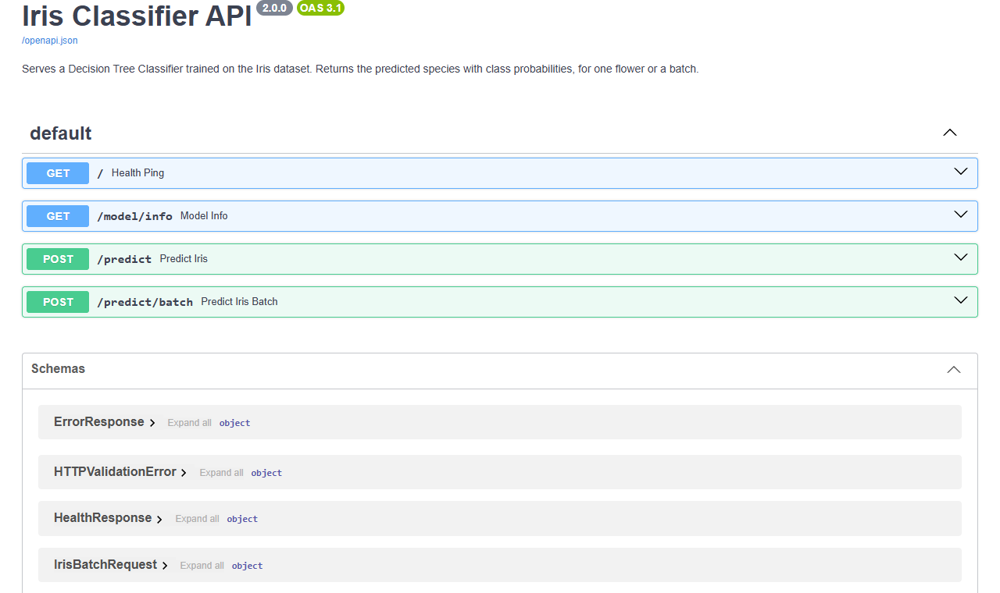
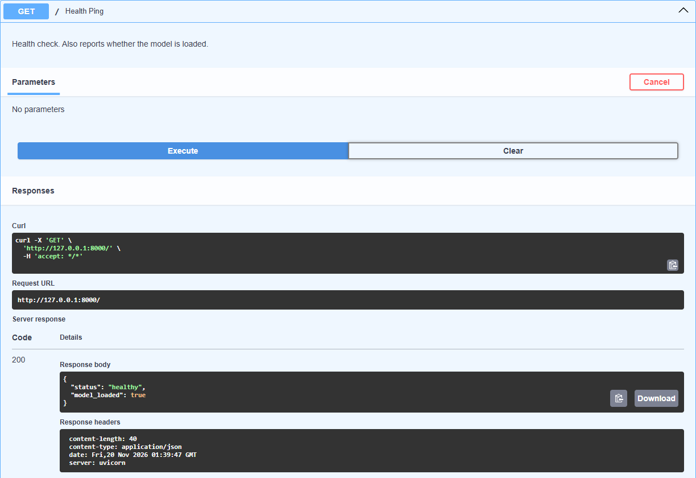
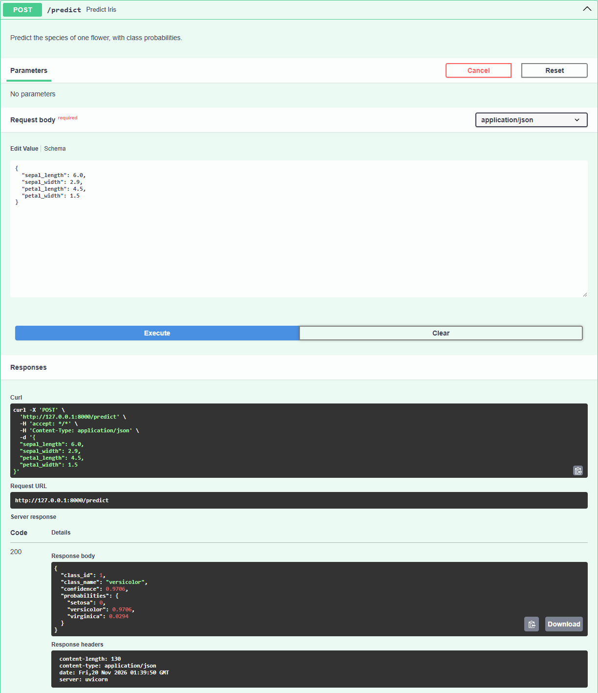
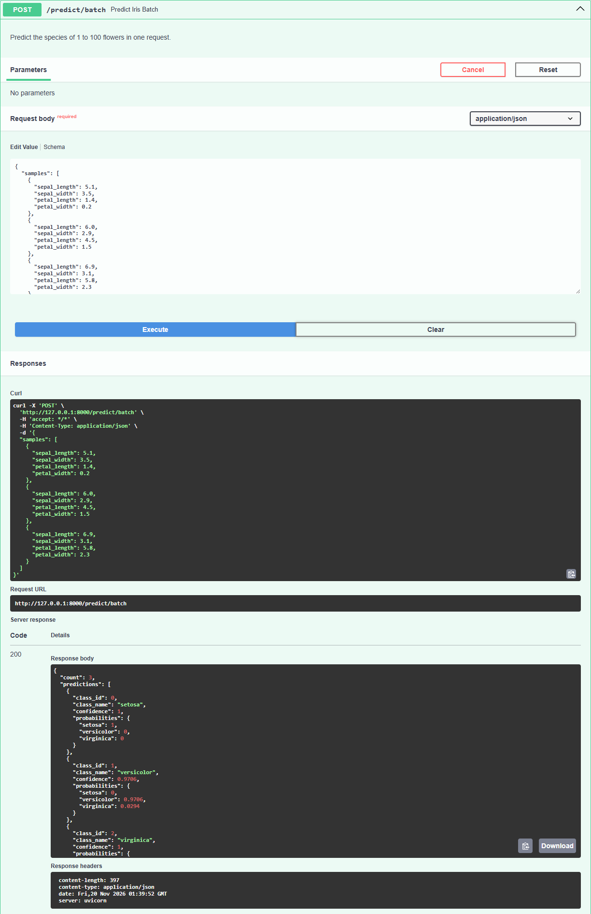
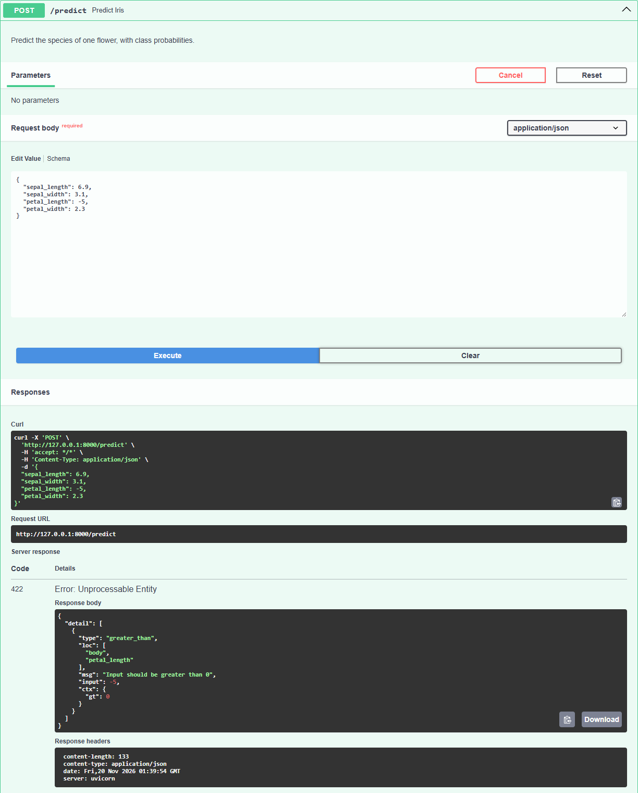
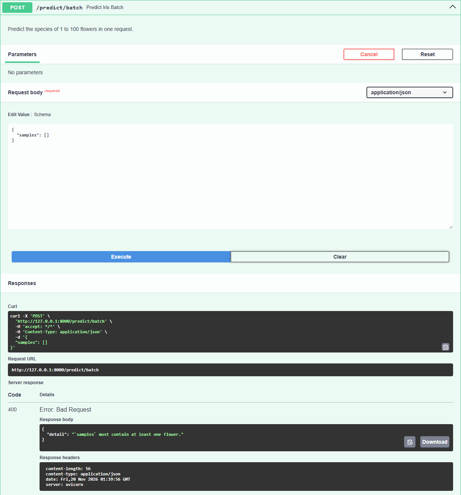
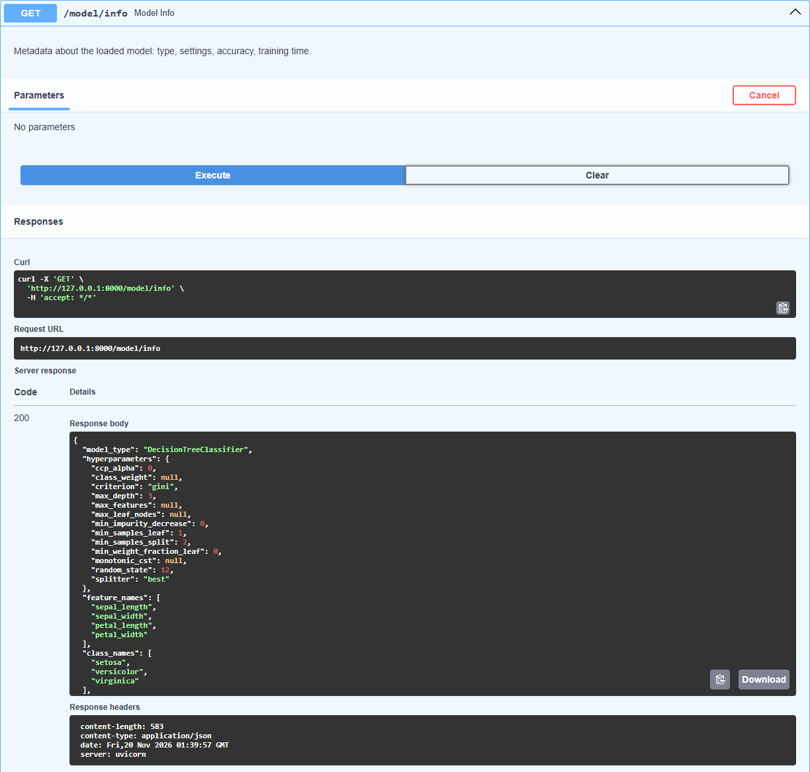

# FastAPI Lab – Iris Classifier API

For this lab I trained a Decision Tree on the Iris dataset and served it as an API using FastAPI and uvicorn. The starting point was the FastAPI lab from class. That version had one `/predict` endpoint that just returned a number (0, 1 or 2). I changed the API part of the lab, since that's the main concept:

- the predict response now includes the flower name and probabilities
- input values are validated, so bad measurements get rejected
- there's a new batch endpoint that predicts many flowers at once
- the model loads once when the server starts, and there's a new `/model/info` endpoint

The full details of what I changed are in the [What I changed](#what-i-changed) section near the bottom.

## What you need installed

I tested everything on Windows 11 with **Python 3.11.8**. Python 3.10–3.13 should probably work too, but 3.11 is the one I know works.

1. **Python 3.11.** Download it from https://www.python.org/downloads/. On Windows, make sure you tick **"Add python.exe to PATH"** on the first screen of the installer.
2. **Git.** Download it from https://git-scm.com/downloads.

To check both are installed, open a new terminal and run:

```bash
python --version    # should say Python 3.11.x (on Mac/Linux use python3)
git --version
```

On Windows, if `python` opens the Microsoft Store or shows a different version, use `py -3.11` instead.

Everything else gets installed with pip from `requirements.txt`:

- `fastapi[all]==0.165.0`: FastAPI. The `[all]` part also installs uvicorn (the server) and httpx (which the tests need).
- `scikit-learn==1.9.1`: the dataset and the Decision Tree model
- `joblib==1.6.0`: saving and loading the model
- `numpy==2.4.6`
- `pytest==9.2.0`: for running the tests

## Setup

Clone the repo:

```bash
git clone https://github.com/benoyj20/FastAPI_Lab.git
cd FastAPI_Lab
```

Create a virtual environment, activate it, and install the packages.

On **Windows (PowerShell)**:

```powershell
py -3.11 -m venv fastapi_lab_env
.\fastapi_lab_env\Scripts\Activate.ps1
pip install -r requirements.txt
```

If PowerShell gives an error like *"running scripts is disabled on this system"*, run this once and then try activating again:

```powershell
Set-ExecutionPolicy -Scope CurrentUser -ExecutionPolicy RemoteSigned
```

On **Mac/Linux**:

```bash
python3 -m venv fastapi_lab_env
source fastapi_lab_env/bin/activate
pip install -r requirements.txt
```

Once it's activated you should see `(fastapi_lab_env)` at the start of your terminal prompt. If you open a new terminal you have to activate it again.

## Running the lab

### 1. Train the model

```bash
cd src
python train.py
```

You should see something like this:

```
Model saved to ...\FastAPI_Lab\model\iris_model.pkl
Metadata saved to ...\FastAPI_Lab\model\model_info.json
Test accuracy: 0.9778
```

This creates two files in the `model/` folder:
- `iris_model.pkl`: the trained model
- `model_info.json`: info about the model, which the API returns at `/model/info`

### 2. Start the API

Still inside `src/`, run:

```bash
uvicorn main:app --reload
```

`main` is the file name (`main.py`) and `app` is the FastAPI object inside it. `--reload` restarts the server whenever you save a code change.

If it worked, you'll see this. The important line is `Loaded model from ...`:

```
INFO:     Uvicorn running on http://127.0.0.1:8000 (Press CTRL+C to quit)
INFO:     Started reloader process [...] using WatchFiles
INFO:     Started server process [...]
INFO:     Waiting for application startup.
INFO:     Loaded model from ...\FastAPI_Lab\model\iris_model.pkl
INFO:     Application startup complete.
```

Keep this terminal open while you test. `Ctrl+C` stops the server.

### 3. Test it in the browser

Go to **http://127.0.0.1:8000/docs**. This page lists all the endpoints. To try one:

1. Click an endpoint, e.g. `POST /predict`.
2. Click **Try it out**. The request body is already filled in with an example flower.
3. Click **Execute**. The result shows up under **Response body**.

### 4. Test it from the terminal (optional)

Open a second terminal, since the server is still running in the first one. Below are the commands I used, with the responses I got.

**Health check:**

```bash
curl http://127.0.0.1:8000/
```
```json
{"status": "healthy", "model_loaded": true}
```

**Predict one flower:**

```bash
curl -X POST http://127.0.0.1:8000/predict \
  -H "Content-Type: application/json" \
  -d '{"sepal_length": 6.0, "sepal_width": 2.9, "petal_length": 4.5, "petal_width": 1.5}'
```
```json
{
  "class_id": 1,
  "class_name": "versicolor",
  "confidence": 0.9706,
  "probabilities": {"setosa": 0.0, "versicolor": 0.9706, "virginica": 0.0294}
}
```

**Predict a batch:**

```bash
curl -X POST http://127.0.0.1:8000/predict/batch \
  -H "Content-Type: application/json" \
  -d '{"samples": [
        {"sepal_length": 5.1, "sepal_width": 3.5, "petal_length": 1.4, "petal_width": 0.2},
        {"sepal_length": 6.9, "sepal_width": 3.1, "petal_length": 5.8, "petal_width": 2.3}
      ]}'
```
```json
{
  "count": 2,
  "predictions": [
    {"class_id": 0, "class_name": "setosa", "confidence": 1.0, "probabilities": {"setosa": 1.0, "versicolor": 0.0, "virginica": 0.0}},
    {"class_id": 2, "class_name": "virginica", "confidence": 1.0, "probabilities": {"setosa": 0.0, "versicolor": 0.0, "virginica": 1.0}}
  ]
}
```

**Model info:**

```bash
curl http://127.0.0.1:8000/model/info
```

This returns the model type, its hyperparameters, the test accuracy (0.9778), how many samples it was trained and tested on (105 and 45), when it was trained, and the scikit-learn version.

**Bad input (negative petal length):**

```bash
curl -X POST http://127.0.0.1:8000/predict \
  -H "Content-Type: application/json" \
  -d '{"sepal_length": 6.9, "sepal_width": 3.1, "petal_length": -5, "petal_width": 2.3}'
```
```json
{"detail": [{"type": "greater_than", "loc": ["body", "petal_length"], "msg": "Input should be greater than 0", "input": -5, "ctx": {"gt": 0.0}}]}
```

This one comes back with status code 422.

**On Windows PowerShell:** `curl` in Windows PowerShell is a different command, so the examples above won't work there. Use these instead:

```powershell
Invoke-RestMethod http://127.0.0.1:8000/

$body = @{ sepal_length = 6.0; sepal_width = 2.9; petal_length = 4.5; petal_width = 1.5 } | ConvertTo-Json
Invoke-RestMethod -Method Post -Uri http://127.0.0.1:8000/predict -ContentType "application/json" -Body $body

$batch = @{ samples = @(
    @{ sepal_length = 5.1; sepal_width = 3.5; petal_length = 1.4; petal_width = 0.2 },
    @{ sepal_length = 6.9; sepal_width = 3.1; petal_length = 5.8; petal_width = 2.3 }
) } | ConvertTo-Json -Depth 5
(Invoke-RestMethod -Method Post -Uri http://127.0.0.1:8000/predict/batch -ContentType "application/json" -Body $batch).predictions

Invoke-RestMethod http://127.0.0.1:8000/model/info
```

### 5. Run the tests

Stop the server with `Ctrl+C`, go back to the main project folder, and run pytest:

```bash
cd ..
pytest
```

You should get:

```
....................                                                     [100%]
20 passed in 3.00s
```

The tests use FastAPI's `TestClient`, so the server doesn't need to be running. I also set up a GitHub Actions workflow, like in the GitHub lab, that runs these tests on every push to `main`.

## Screenshots

These are from the `/docs` page while the server was running.

**All the endpoints:**



**Health check.** It shows the model is loaded:



**Predicting one flower.** The response has the name and probabilities:



**Batch prediction with 3 flowers:**



**A negative petal length gets rejected with a 422:**



**An empty batch gets a 400:**



**Model info:**



## Endpoints

| Method | Endpoint | What it does |
|--------|----------|--------------|
| GET | `/` | Health check. Also says whether the model is loaded. |
| GET | `/model/info` | Info about the loaded model |
| POST | `/predict` | Predicts one flower |
| POST | `/predict/batch` | Predicts 1 to 100 flowers at once |

Every request needs these four fields, in cm: `sepal_length`, `sepal_width`, `petal_length`, `petal_width`. Each must be more than 0 and at most 10.

The classes are 0 = setosa, 1 = versicolor and 2 = virginica.

Error codes you might see:
- **422**: a field is missing, isn't a number, or is out of range
- **400**: the batch is empty or has more than 100 flowers
- **503**: the model wasn't found when the server started (run `train.py` and restart the server)

## What I changed

The original lab had:
- a `GET /` health check
- a `POST /predict` endpoint that accepted any four floats and returned `{"response": 2}`
- model loading from the `.pkl` file on every request

Here's what I changed and why.

### 1. Better prediction response

I changed `IrisResponse` so it returns more than just the class number:

```
Before: {"response": 2}
After:  {"class_id": 2, "class_name": "virginica", "confidence": 1.0, "probabilities": {...}}
```

To do this, `predict.py` now calls `predict_proba()` as well as `predict()`. Getting back just "2" isn't very useful. With this change you can see the actual species and how sure the model is. Since `IrisResponse` is the `response_model`, FastAPI also shows all these fields in `/docs`.

### 2. Input validation with Pydantic

In the original lab you could send something like a negative petal length and still get a prediction, which doesn't make sense. I used Pydantic `Field(gt=0, le=10)` on each measurement, so values that aren't between 0 and 10 cm get a 422 error. The error message tells you which field was wrong.

I also added an example to the model, so the request body in `/docs` is already filled in when you click "Try it out".

The original `IrisData` listed the fields in a different order than the model was trained on. So I added a `to_features()` method that always puts them in the right order (sepal length, sepal width, petal length, petal width).

### 3. Batch prediction endpoint

I added `POST /predict/batch`. It takes a list of flowers and returns a prediction for each one. All of them go through the model in one call instead of one at a time.

While building this I learned about the two different kinds of errors:
- If one flower in the list has a bad value, Pydantic rejects it with a **422**, and the error points to that exact flower, e.g. `["body", "samples", 1, "sepal_width"]`.
- If the list is empty or has more than 100 flowers, my code raises an `HTTPException` with a **400**. That's a rule I made up, not a data type problem.

### 4. Load the model at startup + `/model/info` endpoint

The original lab loaded the model from disk every time someone called `/predict`. I used FastAPI's `lifespan` feature to load it once when the server starts.

All the endpoints that need the model use a shared dependency (`get_model`, through `Depends`). If the model files don't exist, those endpoints return a **503** saying to run `train.py`, instead of crashing. The health check now also reports `model_loaded: true/false`. That way you can tell the difference between "the server is running" and "the server can actually make predictions".

I also changed `train.py` to save a `model_info.json` file next to the model. It has the model type, hyperparameters, test accuracy, train/test sizes, when it was trained, and the scikit-learn version. The new `GET /model/info` endpoint returns it, so you can check which model is running without opening any files.

### Smaller changes

- File paths are based on where the script is, so `train.py` works whether you run it from `src/` or from the main folder.
- The train/test split is stratified, so each class is equally represented in the test set.
- I added the 400 and 503 errors to the routes with `responses=`, so they show up in `/docs` and aren't marked "Undocumented".
- I wrote 20 tests in `tests/test_api.py` covering all of the above, including the 503 case when the model is missing.
- I added a GitHub Actions workflow that trains the model and runs the tests on every push.

## Project structure

```
FastAPI_Lab
├── .github/workflows/
│   └── pytest_action.yml   # runs the tests on GitHub
├── assets/                 # screenshots
├── model/
│   ├── iris_model.pkl      # trained model (made by train.py)
│   └── model_info.json     # model info (made by train.py)
├── src/
│   ├── __init__.py
│   ├── data.py             # loads and splits the Iris data
│   ├── main.py             # the FastAPI app and endpoints
│   ├── predict.py          # loads the model and makes predictions
│   └── train.py            # trains and saves the model
├── tests/
│   └── test_api.py         # tests for the endpoints
├── .gitignore
├── README.md
└── requirements.txt
```

The `fastapi_lab_env/` folder gets created during setup. It's in `.gitignore`, so it isn't in the repo.

## Problems I ran into / troubleshooting

- **`ModuleNotFoundError: No module named 'fastapi'`**: the virtual environment isn't activated. Activate it and try again.
- **`Could not import module "main"`**: you have to be inside the `src/` folder when you run uvicorn.
- **Endpoints return 503**: the model hasn't been trained yet. Run `python train.py` in `src/`, then restart the server.
- **Port 8000 already in use**: run `uvicorn main:app --reload --port 8001` and use 8001 in the URLs instead.
- **PowerShell won't activate the environment**: see the `Set-ExecutionPolicy` command in the Setup section.
